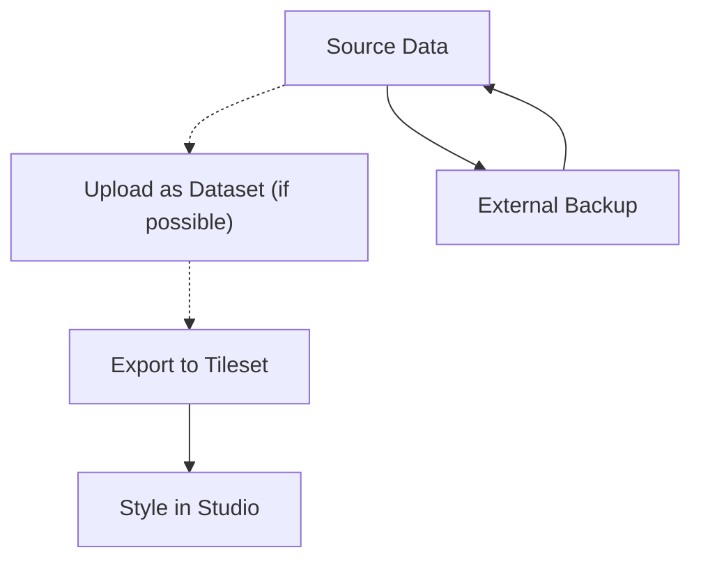

# Mapbox

[Mapbox](https://www.mapbox.com/) es una plataforma de mapeo que proporciona la base para mapas interactivos en todas las instancias de Guardian Connector.

## Cómo se usa Mapbox en Guardian Connector

Mapbox cumple tres propósitos principales en las implementaciones de Guardian Connector:

- **Tokens de acceso para mapas básicos** - Compartidos entre instancias de GC para proporcionar capas de mapa base y funcionalidad de mapeo estándar para herramientas como [Superset](/reference/gc-toolkit/superset/).
- **Estilos de mapa personalizados** - Creados en Mapbox Studio para mapas específicos o paneles de alertas en [GC Explorer](/reference/gc-toolkit/gc-explorer/).
- **Mapas sin conexión** - Los estilos de Mapbox se pueden compilar en paquetes de mapas sin conexión para su uso en [CoMapeo](/reference/core-integrations/comapeo/) utilizando herramientas como [QGIS](https://www.qgis.org/) y [MapPacker](https://github.com/conservationmetrics/mappacker).

## Comprensión de la arquitectura de datos de Mapbox

Mapbox organiza los datos geoespaciales a través de tres componentes principales que trabajan juntos para ofrecer mapas interactivos:

### Datasets
Los **Conjuntos de datos** son colecciones editables de características GeoJSON almacenadas en Mapbox. Estos representan los datos geoespaciales sin procesar y se pueden modificar característica por característica utilizando el editor de conjuntos de datos de Mapbox Studio o la API de conjuntos de datos.

- **Caso de uso**: Almacenamiento inicial de datos y ediciones continuas.
- **Formato**: GeoJSON FeatureCollection.
- **Editabilidad**: Totalmente editable (agregar, modificar, eliminar características y propiedades).
- **Límites de tamaño**: Sin límite de almacenamiento, pero el editor de Studio solo muestra conjuntos de datos ≤20MB.

### Tilesets
Los **conjuntos de teselas (Tilesets)** son colecciones optimizadas y preprocesadas de datos geoespaciales divididos en una cuadrícula uniforme de teselas en múltiples niveles de zoom (hasta el zoom 22). Los conjuntos de datos deben exportarse a conjuntos de teselas antes de usarlos en los estilos de mapa. Es posible generar conjuntos de teselas directamente sin usar conjuntos de datos, por ejemplo, arrastrando y soltando datos espaciales directamente en el editor de estilos de Mapbox Studio.

- **Caso de uso**: Renderizado y estilo de mapa optimizados.
- **Formato**: Teselas vectoriales (MVT) o teselas ráster.
- **Editabilidad**: Solo lectura una vez procesado.
- **Rendimiento**: Altamente cacheado y optimizado para una carga rápida.

### Styles
Los **Estilos** definen la apariencia visual de los mapas utilizando la [Especificación de Estilos de Mapbox](https://docs.mapbox.com/style-spec/). Hacen referencia a conjuntos de teselas como fuentes de datos y aplican reglas de estilo para crear la apariencia final del mapa.

- **Formato**: Documento JSON (style.json).
- **Componentes**: Fuentes de datos, capas, propiedades de estilo, fuentes e imágenes.
- **Editabilidad**: Se puede modificar en Mapbox Studio o programáticamente.

## Gestión de Datos Basada en la Cuenta

Todos los datos de Mapbox (conjuntos de datos, conjuntos de teselas, estilos) están vinculados a cuentas específicas de Mapbox, lo que genera consideraciones importantes de gestión:

- **Propiedad de la cuenta**: Los datos no se pueden transferir entre cuentas sin procesos explícitos de exportación/importación.
- **Dependencias de facturación**: Las cuentas impagas pueden perder acceso a los datos y deshabilitar la funcionalidad del mapa.
- **Control de acceso**: Los estilos y conjuntos de teselas privados solo son accesibles con tokens de acceso válidos de la cuenta propietaria.

### Consideraciones para la Configuración de la Cuenta

**Nomenclatura organizacional**: Al configurar cuentas de Mapbox para instancias de Guardian Connector, utilice nombres organizacionales como `OrganizationName-GC` en lugar de nombres personales. Esto es fundamental porque los ID de cuenta no se pueden cambiar después de la creación, y los tokens de acceso no son transferibles entre cuentas.

**Implementaciones multicliente**: Para organizaciones que gestionan varias instancias de Guardian Connector para diferentes clientes, configure cuentas de Mapbox únicas para cada cliente. Esta configuración 1:1 permite:
- Los clientes asumirán la futura propiedad de su cuenta.
- Acceso independiente a las estadísticas de uso de sus proyectos.  
- Gestión directa de la facturación
- Cada cliente recibirá su propio nivel gratuito de llamadas API.

:::tip 

Mapbox permite alias con el signo más (como `your-email+mapbox-1@example.com`, `your-email+mapbox-2@example.com`, etc.) para los nombres de cuenta. Esta es una buena práctica para facilitar la gestión de cuentas.

:::

Para una guía completa sobre la configuración de cuentas y la colaboración, consulte las [mejores prácticas de colaboración de Mapbox](https://docs.mapbox.com/help/troubleshooting/collaboration-best-practices/).

### Limitaciones de la Portabilidad de Datos

**Estilos**
- **Estilos públicos**: Pueden ser copiados por otros usuarios a través de enlaces para compartir.
- **Estilos privados**: Deben descargarse como JSON y volverse a cargar manualmente en nuevas cuentas.
- **Activos personalizados**: Las fuentes e iconos requieren transferencia separada.

**Conjuntos de Teselas**
- **Conjuntos de teselas públicos**: Pueden ser referenciados por otras cuentas, pero no transferidos realmente.
- **Conjuntos de teselas privados**: No se pueden copiar directamente; requieren la recarga de los datos de origen.
- **Riesgo de pérdida de datos**: Si los datos de origen se pierden, los conjuntos de teselas no se pueden exportar directamente desde Mapbox Studio, pero las características vectoriales se pueden descargar y reconstruir en GeoJSON utilizando el script [Descarga y reconstrucción de teselas vectoriales](/reference/gc-toolkit/externally-hosted/mapbox/download-vector-tiles/).

## Estrategias de carga y preservación de datos

Mapbox ofrece múltiples formas de agregar datos a su cuenta, cada una con diferentes implicaciones para la preservación de datos:

**Carga directa al editor de estilos**:
- **Proceso**: Arrastrar y soltar datos espaciales directamente en el editor de estilos de Mapbox Studio.
- **Resultado**: Los datos se convierten inmediatamente en conjuntos de teselas sin conjuntos de datos intermedios.
- **Riesgo**: Los datos de origen originales no se conservan y no se pueden recuperar.

**Enfoque de conjunto de datos primero (recomendado)**:
- **Proceso**: Cargar datos como conjunto de datos → editar si es necesario → exportar a conjunto de teselas → aplicar estilo en Studio.
- **Resultado**: Preserva tanto los datos brutos (conjunto de datos) como los datos optimizados (conjunto de teselas).
- **Beneficios**: Los datos permanecen editables y recuperables.

Para obtener más información sobre las diferencias entre estos enfoques, consulte la [documentación de Mapbox "Cargar datos a Mapbox"](https://docs.mapbox.com/help/troubleshooting/uploads/).

### Flujo de Trabajo Recomendado

**Mejores prácticas para la preservación de datos**:
1. **Mantenga siempre copias de seguridad externas** de los datos de origen en control de versiones o almacenamiento en la nube.
2. **Cargue como conjuntos de datos primero** si es posible, para preservar la editabilidad y los datos de origen.
3. **Documentar las fuentes de datos** y los flujos de trabajo de procesamiento.
4. **Exportar a conjuntos de teselas** solo cuando los datos estén finalizados para el estilo.
5. **Control de versiones de archivos JSON de estilo** cuando sea posible.

## Primeros Pasos

1. Cree una cuenta de Mapbox en [mapbox.com](https://www.mapbox.com/).
2. Genere un token de acceso para su implementación de Guardian Connector.
3. Configure el token de acceso en sus variables de entorno de GC Explorer y Superset.
4. Opcionalmente, cree estilos de mapa personalizados en Mapbox Studio para vistas y paneles específicos.

:::warning Mejor Práctica de Seguridad

Restrinja siempre su token de acceso de Mapbox a URL y referentes específicos para evitar el uso no autorizado. Configure las restricciones de URL en la configuración de su cuenta de Mapbox.

:::

## Documentación Relacionada

- [Personalización de sus estilos de Mapbox](./customization.md) - Modifique los estilos de Mapbox y agregue capas de mapa personalizadas para Guardian Connector.
- [Actualización de un conjunto de teselas de Mapbox](./update-tileset.md) - Sincroniza automáticamente un archivo GeoJSON en Guardian Connector con un conjunto de teselas de Mapbox.
- [Descarga y reconstrucción de teselas vectoriales](./download-vector-tiles.md) - Descarga teselas vectoriales de Mapbox para un cuadro delimitador y las reconstruye en GeoJSON.
- [Manual de Mapbox Studio](https://docs.mapbox.com/studio-manual/) - Guía completa para la gestión y el estilo de datos.
- [Especificación de estilos de Mapbox](https://docs.mapbox.com/style-spec/) - Especificación técnica para estilos de mapa.
- [Gestión de Cuentas de Mapbox](https://docs.mapbox.com/accounts/guides/) - Configuración de cuenta y seguridad.
- [Solución de problemas de carga de datos](https://docs.mapbox.com/help/troubleshooting/uploads/) - Problemas comunes de carga y soluciones.