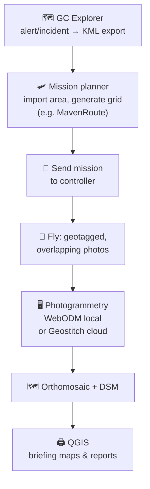

# De Alertas de Mineração a Mapas de Drone

## Introduction

Quando [alertas de detecção de mudança](/reference/gc-toolkit/gc-explorer/) mostram nova atividade de mineração, a parte difícil é muitas vezes a distância: um local pode estar a horas de qualquer rio ou estrada, e uma expedição de campo custa dias do tempo da equipe. Nem todo alerta justifica essa viagem.

Um voo de drone automatizado é uma forma barata de “visitar” o local sem ir. O drone voa um caminho planejado, captura várias fotos geotagged sobrepostas, e o software as costura num **ortomosaico** — um mapa contínuo e de alta resolução. Esse mapa responde à maioria das perguntas que uma visita de campo faria: o que aconteceu aqui, quão grande é, se as máquinas estão funcionando, em que direção está crescendo. A equipe então decide se a viagem presencial é realmente necessária.

Este fluxo de trabalho anda de mãos dadas com [Preparação de Briefings de Campo de Alerta de Mineração](/guides/land-monitoring/guide-mining-alert-field-briefings/): os mesmos alertas, os mesmos pacotes de briefing e relatórios — só que agora as páginas do local são geradas a partir de mapas de drones com resolução de centímetros em vez de imagens de satélite.

<div className="center-diagram">



</div>

Este guia assume que você já trabalha confortavelmente com QGIS e GC Explorer, e que sua organização possui um drone capaz de mapeamento e um piloto que o opera de acordo com as regras nacionais de drones.

## Passo 1: Exportar o local de mineração do GC Explorer

No **Painel de Alertas** do [GC Explorer](/reference/gc-toolkit/gc-explorer/), revise o que se acumulou desde sua última viagem de campo, descarte artefatos e exporte os locais que valem a pena voar como **KML**:

- **exportação em lote** de todos os alertas visíveis (respeitando o filtro de tempo),
- um **alerta único** clicado no mapa,
- ou um **[incidente](/reference/gc-toolkit/gc-explorer/incidents/)** completo se o local tiver acionado alertas várias vezes.

:::important
KML é o formato a ser usado aqui — os planejadores de missão aceitam um polígono ou contorno KML diretamente como a área de pesquisa. A exportação GeoJSON do [guia de briefing de campo](/guides/land-monitoring/guide-mining-alert-field-briefings/) continua sendo a escolha certa para a análise do QGIS; as duas exportações descrevem o mesmo local e se alinharão exatamente, pois tudo o que o Guardian Connector publica está em WGS84.
:::

:::tip
Dimensione o voo de acordo com o que você precisa *ver*. Uma operação de 2 hectares e um lago de 20 hectares são missões diferentes — em caso de dúvida, voe a área alertada mais uma margem de 30–50 m de cada lado, para que o mapa mostre um contexto que o alerta via satélite não pode, e/ou monitore o voo automatizado enquanto ele acontece para detectar qualquer mudança que valha a pena capturar.
:::

## Passo 2: Planeje a missão

Qualquer planejador que transforme um polígono em uma grade de fotos servirá. Este guia detalha o **MavenRoute**, o planejador de missão web do ecossistema [MavenPilot](https://www.mavenpilot.com/) — mas cada etapa é a mesma em qualquer outra ferramenta: abra uma área, defina altitude e sobreposição, gere a grade, envie-a para o controlador.

### Importar o local

Crie uma nova missão de **fotogrametria / mapeamento** no planejador e importe o KML do alerta como a área de levantamento. Gire a grade para correr ao longo do eixo maior da área — menos voltas, voo mais curto, mesma cobertura.

### Definir os parâmetros

| Parameter | Regra geral para alertas de mineração |
| --- | --- |
| **Sobreposição** | ~50% de frente e lateral é suficiente para um ortomosaico limpo de um local. |
| **Altitude** | Escolha a altura pelo detalhe que você deve resolver, não o contrário: voe baixo o suficiente para que as trilhas de veículos, bordas de poços ou maquinário sejam identificáveis, mas tão alto quanto consistente com isso, para que um voo cubra o local. A altitude define diretamente sua resolução (distância de amostra do solo) — ~300 metros é geralmente o ponto ideal. |
| **Tamanho da missão** | Mantenha cada missão dentro de **uma bateria**: a grade deve terminar com uma reserva confortável, e um local que precise de troca de bateria no meio da missão produz dois mapas parcialmente cobertos. Se a área for muito grande, divida-a em duas missões sobre metades adjacentes, em vez de forçar um único voo. |

:::tip
Salve o arquivo da missão. Voar o *mesmo* caminho sobre o mesmo local meses depois fornece mapas diretamente comparáveis — é assim que um voo de drone se transforma em monitoramento repetido, em vez de documentação única.
:::

### Ajuste e exporte para o controlador

Visualize a grade gerada sobre imagens de satélite e ajuste manualmente se uma linha obviamente perder a área ativa. Em seguida, mova a missão do planejador para o controlador:

- **No ecossistema Maven**: transfira do MavenRoute para o aplicativo **Maven** no controlador via MavenShare; para aeronaves DJI Fly que não podem executar aplicativos de terceiros, exporte a missão como **KMZ** e envie-a para o controlador com a ferramenta desktop gratuita **MavenBridge**.
- **Caso contrário**: use o caminho nativo do seu drone — o DJI Pilot 2 importa rotas planejadas e possui missões de mapeamento integradas, plataformas empresariais como eBee ou Wingtra têm seus próprios planejadores.

:::nota
O DJI Fly não oferece uma forma para ferramentas externas *criarem* uma missão, então o **MavenBridge funciona substituindo uma missão que já existe no controlador**. Faça isso uma vez com antecedência: salve qualquer pequena missão de waypoint no DJI Fly e, em seguida, permita que cada transferência do MavenBridge sobrescreva esse slot com sua grade planejada — o controlador sempre mantém sua missão mais recente. Uma ressalva: a missão a ser substituída deve ser armazenada *fisicamente no dispositivo*, não na sua nuvem DJI; se o MavenBridge não a listar, abra a missão uma vez no DJI Fly e feche-a, o que a baixará localmente. A [página de documentação do MavenBridge](https://www.mavenpilot.com/mavenbridge/) detalha a transferência completa (com um vídeo de demonstração), e o [hub de tutoriais em vídeo](https://www.mavenpilot.com/tutorial/) da Maven cobre o fluxo de trabalho do planeador ao voo de ponta a ponta.
:::

:::nota
O campo de aplicativos de planejamento move-se rapidamente e inclui DroneDeploy, Pix4Dcapture, UgCS, Dronelink, QGroundControl e mais; veja a comparação de software de mapeamento no [guia de mapeamento de drones da UAV Coach](https://uavcoach.com/drone-mapping/) para uma visão geral atual.
:::

## Passo 3: Voe e verifique antes de sair

A missão agora voa sozinha — altitude, velocidade, intervalos de foto exatamente como configurado. Essa automação é o ponto principal, porque a **fotogrametria só é bem-sucedida se cada foto atender às condições das quais a costura depende**: sobreposição suficiente com suas vizinhas, escala consistente de uma altura constante, quadros nítidos o suficiente para corresponder e carimbos GPS precisos. Quando alguém voa um local manualmente e tira fotos por instinto, uma ou mais dessas condições geralmente falham *silenciosamente* — e você só descobre isso no momento do processamento, longe do local, quando o mapa tem buracos ou se recusa a alinhar. Uma grade planejada é uma garantia, definida com antecedência, de que o conjunto de dados produzirá um mapa.

No campo:

- Câmera em **nadir** (diretamente para baixo), disparo em intervalo controlado pela missão — não o substitua por quadros manuais.
- Observe a tela: confirme que as fotos estão realmente sendo tiradas na taxa planejada.
- Antes de arrumar, dê uma olhada na cobertura capturada. Uma lacuna ou uma série de quadros borrados pode ser corrigida voando novamente *agora*, e é impossível de corrigir depois que você está a horas do local.

## Passo 4: Processe as fotos em um mapa

A costura (fotogrametria por estrutura-a-partir-do-movimento) transforma as imagens em:

- um **ortomosaico** (GeoTIFF) — o mapa que você realmente usará,
- um **DEM** (modelo de elevação) — opcional, se você se importa com a profundidade do poço ou volumes de estoque,
- um **relatório** de qualidade e a nuvem de pontos georreferenciada bruta, para os casos raros que precisam deles.

Ferramentas comerciais (Pix4D, Metashape, DJI Terra, DroneDeploy) também fazem isso; este guia foca na família gratuita e de código aberto **OpenDroneMap**: o motor de linha de comando **ODM**, a interface de navegador **WebODM** e a API de rede **NodeODM**. Existem várias outras ferramentas neste espaço que não abordaremos — a escolha importa menos do que a captura que você traz para elas.

### Localmente, em um computador potente

O processamento consome muita memória; a regra honesta é *mais fotos → mais RAM*.

A configuração mais fácil é o Docker — solte as imagens em uma pasta de conjunto de dados e execute:

```bash
docker run -ti --rm -v /datasets:/datasets opendronemap/odm \
  --project-path /datasets site-a3
```

ou inicie a interface WebODM ([guia de instalação](https://webodm.org/download/)) e crie a tarefa no navegador: carregue a pasta de imagens, mantenha as opções padrão e abra o resultado quando a tarefa terminar. O ortomosaico está sempre em `odm_orthophoto/odm_orthophoto.tif`.

:::tip
Para um mapa de triagem rápido, use a configuração **fast-orthomosaic** (`--fast-orthomosaic`) mais `--dsm` apenas se precisar de elevações. Você obtém um mapa do local utilizável em uma fração do tempo; reprocesse com qualidade total apenas para locais que provarem ser importantes.
:::

### Na nuvem, sem o hardware

Se nenhum computador da equipe puder suportar a RAM, o [Geostitch](https://geostitch.io/) é um frontend web gratuito que impulsiona o mesmo motor ODM (via NodeODM): crie uma conta, carregue as imagens de voo e escolha onde o processamento acontece — seu próprio nó NodeODM se você tiver uma máquina potente, um servidor alugado por mês, ou computação em nuvem **paga por trabalho**. A interface, projetos e exportações não custam nada; o processamento sim — o modo “pago por trabalho” usa créditos pré-pagos cujo custo escala com a contagem de imagens e a predefinição de qualidade, e os servidores alugados começam com uma taxa mensal fixa. Ainda assim, a conta é uma pequena fração do custo de uma estação de trabalho capaz de costurar os mesmos conjuntos de dados localmente, e você nunca paga por hardware parado entre expedições.

:::nota
O processamento na nuvem ainda exige *upload* — algumas centenas de fotos são 5–20 GB. No campo, traga as imagens para casa no cartão SD; execute a partir daí, seja localmente ou na nuvem. A internet lenta no campo quebra o fluxo de trabalho de qualquer forma, não apenas a opção de nuvem.
:::

## Passo 5: Carregue no QGIS, imprima, relate

Mantenha a mesma disciplina de pastas do guia de briefing — uma pasta por viagem de campo, projeto apontando para caminhos relativos:

```text
2026-09_site-a3/
├── alerts/            # KML/GeoJSON from GC Explorer
├── drone/
│   ├── images/        # untouched originals from the SD card
│   └── odm/           # processing output (orthophoto, DSM, report)
├── field_trip.qgz
└── printed/           # briefing packet PDF
```

Carregue `odm_orthophoto.tif` como uma camada raster (Camada → Adicionar Camada → Adicionar Camada Raster). Ele carrega suas coordenadas, então ele se posiciona exatamente sobre o polígono de alerta — que é em si a primeira descoberta: um mapa em escala de centímetros ou confirma ou anula o alerta, e muitas vezes mostra a verdadeira pegada estendendo-se além do que o satélite sinalizou.

O principal trabalho é a impressão. Substitua o ortomosaico **sob os layouts de impressão existentes** do [guia de briefing de campo](/guides/land-monitoring/guide-mining-alert-field-briefings/): as mesmas páginas por local que o conselho já reconhece — título, rótulos, barra de escala, legenda — agora mostram o local com detalhes suficientes para contar máquinas e ler o caminho de acesso. Esse já é todo o retorno; resista a adicionar trabalho.

:::info Análise opcional — apenas quando uma questão permanece
Se o mapa em papel ainda deixar uma questão em aberto, o QGIS pode responder a duas que importam para relatórios de mineração: medir a área perturbada em hectares (Calculadoras de Campo / *$area* numa pegada digitalizada) e digitalizar o contorno **verificado** para substituir o polígono de alerta ao registrar o local num [incidente](/reference/gc-toolkit/gc-explorer/incidents/). Qualquer coisa além disso — volumes, mudança de profundidade entre voos — precisa do DSM e pertence a um projeto separado e posterior.
:::

## Documentação relacionada

- [Preparando Briefings de Campo de Alerta de Mineração](/guides/land-monitoring/guide-mining-alert-field-briefings/) — o fluxo de trabalho complementar que este alimenta
- [Use seus dados no QGIS](/reference/common-workflows/use-your-data-in-qgis/) — dados do Guardian Connector para o QGIS
- [Incidentes no GC Explorer](/reference/gc-toolkit/gc-explorer/incidents/) — registre a pegada verificada e feche o ciclo

## 📚 Leitura adicional

- [MavenPilot / MavenRoute](https://www.mavenpilot.com/) — o planejador de exemplo usado aqui, com [MavenShare](https://www.mavenpilot.com/maven-ecosystem/) e [MavenBridge](https://www.mavenpilot.com/mavenbridge/) para transferência para o controlador
- [Tutoriais em vídeo da Maven](https://www.mavenpilot.com/tutorial/) — demonstrações completas do fluxo de trabalho do planejamento ao voo
- [UAV Coach: Guia de Mapeamento de Drones](https://uavcoach.com/drone-mapping/) — comparação atualizada regularmente de drones e software de mapeamento
- [Documentação do OpenDroneMap](https://docs.opendronemap.org/) — instalação, opções e saídas
- [Geostitch](https://geostitch.io/) — frontend gratuito para processamento ODM em seu próprio nó, um servidor alugado ou pago por trabalho
- [Documentação do QGIS](https://docs.qgis.org/)
- [Diretrizes de drones da Healthy Country AI para guardas indígenas](https://healthycountryai.org/training.php)
