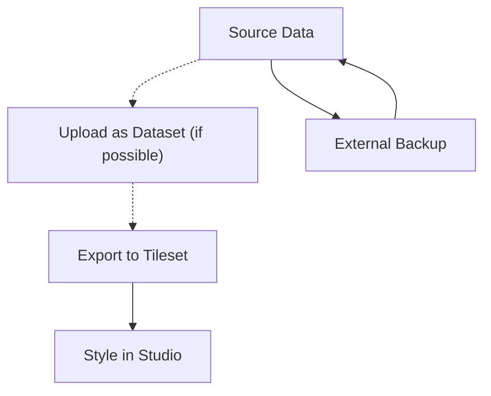

# Mapbox

[Mapbox](https://www.mapbox.com/) é uma plataforma de mapeamento que fornece a base para mapas interativos em todas as instâncias do Guardian Connector.

## Como o Mapbox é usado no Guardian Connector

Mapbox serve a três propósitos principais em implantações do Guardian Connector:

- **Tokens de acesso para mapas básicos** - Compartilhados entre instâncias do GC para fornecer camadas de mapa base e funcionalidade de mapeamento padrão para ferramentas como [Superset](/reference/gc-toolkit/superset/).
- **Estilos de mapa personalizados** - Criados no Mapbox Studio para mapas específicos ou painéis de alertas no [GC Explorer](/reference/gc-toolkit/gc-explorer/).
- **Mapas offline** - Estilos do Mapbox podem ser compilados em pacotes de mapas offline para uso no [CoMapeo](/reference/core-integrations/comapeo/) utilizando ferramentas como [QGIS](https://www.qgis.org/) e [MapPacker](https://github.com/conservationmetrics/mappacker).

## Compreendendo a Arquitetura de Dados do Mapbox

Mapbox organiza dados geoespaciais através de três componentes principais que trabalham juntos para entregar mapas interativos:

### Datasets
**Datasets** são coleções editáveis de feições GeoJSON armazenadas no Mapbox. Estes representam os dados geoespaciais brutos e podem ser modificados feição por feição usando o editor de datasets do Mapbox Studio ou a API de Datasets.

- **Caso de uso**: Armazenamento inicial de dados e edições contínuas.
- **Formato**: GeoJSON FeatureCollection.
- **Editabilidade**: Totalmente editável (adicionar, modificar, excluir feições e propriedades).
- **Limites de tamanho**: Sem limite de armazenamento, mas o editor do Studio exibe apenas datasets ≤20MB.

### Tilesets
**Tilesets** são coleções otimizadas e pré-processadas de dados geoespaciais divididas em uma grade uniforme de tiles em múltiplos níveis de zoom (até o zoom 22). Datasets devem ser exportados para tilesets antes de serem usados em estilos de mapa. É possível gerar tilesets diretamente sem usar datasets, por exemplo, arrastando e soltando dados espaciais diretamente no editor de estilo do Mapbox Studio.

- **Caso de uso**: Renderização e estilização de mapas otimizadas.
- **Formato**: Tiles vetoriais (MVT) ou tiles raster.
- **Editabilidade**: Somente leitura após o processamento.
- **Performance**: Altamente armazenado em cache e otimizado para carregamento rápido.

### Styles
**Estilos** definem a aparência visual dos mapas usando a [Mapbox Style Specification](https://docs.mapbox.com/style-spec/). Eles referenciam tilesets como fontes de dados e aplicam regras de estilo para criar a aparência final do mapa.

- **Formato**: Documento JSON (style.json).
- **Componentes**: Fontes de dados, camadas, propriedades de estilo, fontes e sprites.
- **Editabilidade**: Pode ser modificado no Mapbox Studio ou programaticamente.

## Gerenciamento de Dados Baseado em Conta

Todos os dados do Mapbox (datasets, tilesets, estilos) estão vinculados a contas Mapbox específicas, o que cria considerações importantes de gerenciamento:

- **Propriedade da conta**: Os dados não podem ser transferidos entre contas sem processos explícitos de exportação/importação.
- **Dependências de faturamento**: Contas não pagas podem perder acesso aos dados e desabilitar a funcionalidade do mapa.
- **Controle de acesso**: Estilos e tilesets privados são acessíveis apenas com tokens de acesso válidos da conta proprietária.

### Considerações sobre a Configuração da Conta

**Nomenclatura organizacional**: Ao configurar contas Mapbox para instâncias do Guardian Connector, utilize nomes organizacionais como `OrganizationName-GC` em vez de nomes pessoais. Isso é fundamental porque os IDs das contas não podem ser alterados após a criação, e os tokens de acesso não são transferíveis entre contas.

**Implantações multi-cliente**: Para organizações que gerenciam múltiplas instâncias do Guardian Connector para diferentes clientes, configure contas Mapbox exclusivas para cada cliente. Esta configuração 1:1 permite:
- Os clientes assumirão a futura propriedade de sua conta.
- Acesso independente às estatísticas de uso para seus projetos.  
- Gerenciamento direto de faturamento
- Cada cliente receberá seu próprio nível gratuito de chamadas de API.

:::tip 

Mapbox permite aliases com o sinal de mais (como `your-email+mapbox-1@example.com`, `your-email+mapbox-2@example.com`, etc.) para nomes de conta. Esta é uma boa prática para facilitar o gerenciamento de contas.

:::

Para orientações abrangentes sobre configuração de contas e colaboração, consulte [Melhores práticas de colaboração Mapbox](https://docs.mapbox.com/help/troubleshooting/collaboration-best-practices/).

### Limitações de Portabilidade de Dados

**Estilos**
- **Estilos públicos**: Podem ser copiados por outros usuários via links de compartilhamento.
- **Estilos privados**: Devem ser baixados como JSON e re-carregados manualmente para novas contas.
- **Ativos personalizados**: Fontes e ícones exigem transferência separada.

**Tilesets**
- **Tilesets públicos**: Podem ser referenciados por outras contas, mas não verdadeiramente transferidos.
- **Tilesets privados**: Não podem ser copiados diretamente; exigem re-upload dos dados de origem.
- **Risco de perda de dados**: Se os dados de origem forem perdidos, os tilesets não podem ser exportados diretamente do Mapbox Studio, mas as feições vetoriais podem ser baixadas e reconstruídas em GeoJSON usando o script [Downloading and Reconstructing Vector Tiles](/reference/gc-toolkit/externally-hosted/mapbox/download-vector-tiles/).

## Estratégias de Upload e Preservação de Dados

Mapbox oferece múltiplas maneiras de adicionar dados à sua conta, cada uma com diferentes implicações para a preservação dos dados:

**Upload direto para o editor de estilo**:
- **Processo**: Arraste e solte dados espaciais diretamente no editor de estilo do Mapbox Studio.
- **Resultado**: Dados imediatamente convertidos em tilesets sem datasets intermediários.
- **Risco**: Os dados de origem originais não são preservados e não podem ser recuperados.

**Abordagem dataset-first (recomendado)**:
- **Processo**: Faça upload de dados como dataset → edite se necessário → exporte para tileset → estilize no Studio.
- **Resultado**: Preserva tanto os dados brutos (dataset) quanto os dados otimizados (tileset).
- **Benefícios**: Os dados permanecem editáveis e recuperáveis.

Para mais informações sobre as diferenças entre essas abordagens, consulte a documentação da Mapbox "[Upload data to Mapbox](https://docs.mapbox.com/help/troubleshooting/uploads/)".

### Fluxo de Trabalho Recomendado

**Melhores práticas para preservação de dados**:
1. **Sempre mantenha backups externos** dos dados de origem em controle de versão ou armazenamento em nuvem.
2. **Faça upload como datasets primeiro**, se possível, para preservar a editabilidade e os dados de origem.
3. **Documente as fontes de dados** e os fluxos de trabalho de processamento.
4. **Exporte para tilesets** apenas quando os dados estiverem finalizados para estilização.
5. **Controle de versão de arquivos JSON de estilo** quando possível.

## Primeiros Passos

1. Crie uma conta Mapbox em [mapbox.com](https://www.mapbox.com/).
2. Gere um token de acesso para sua implantação do Guardian Connector.
3. Configure o token de acesso nas variáveis de ambiente do seu GC Explorer e Superset.
4. Opcionalmente, crie estilos de mapa personalizados no Mapbox Studio para visualizações e painéis específicos.

:::warning Melhor Prática de Segurança

Sempre restrinja seu token de acesso do Mapbox a URLs e referenciadores específicos para evitar uso não autorizado. Configure as restrições de URL nas configurações da sua conta Mapbox.

:::

## Documentação Relacionada

- [Customizing your Mapbox styles](./customization.md) - Modifique os estilos do Mapbox e adicione camadas de mapa personalizadas para o Guardian Connector.
- [Updating a Mapbox Tileset](./update-tileset.md) - Sincronize automaticamente um arquivo GeoJSON no Guardian Connector com um tileset do Mapbox.
- [Downloading and Reconstructing Vector Tiles](./download-vector-tiles.md) - Baixe tiles vetoriais do Mapbox para uma caixa delimitadora e reconstrua-os em GeoJSON.
- [Mapbox Studio Manual](https://docs.mapbox.com/studio-manual/) - Guia abrangente para gerenciamento de dados e estilização.
- [Mapbox Style Specification](https://docs.mapbox.com/style-spec/) - Especificação técnica para estilos de mapa.
- [Mapbox Account Management](https://docs.mapbox.com/accounts/guides/) - Configurações de conta e configuração de segurança.
- [Data Upload Troubleshooting](https://docs.mapbox.com/help/troubleshooting/uploads/) - Problemas e soluções comuns de upload.